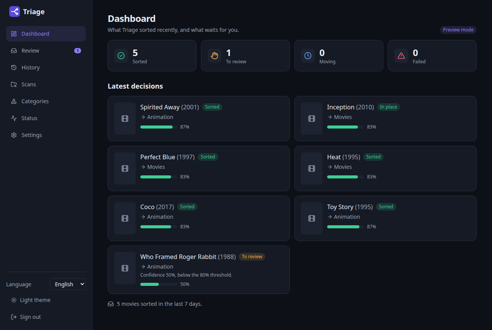
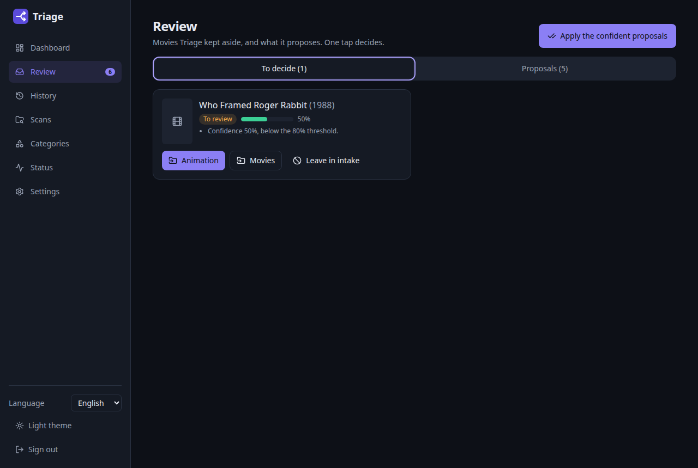
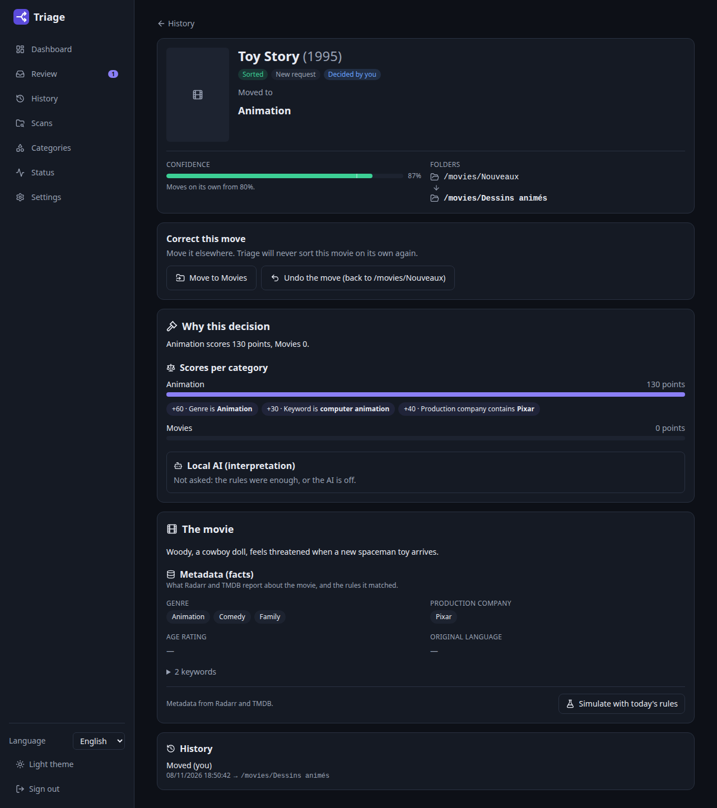
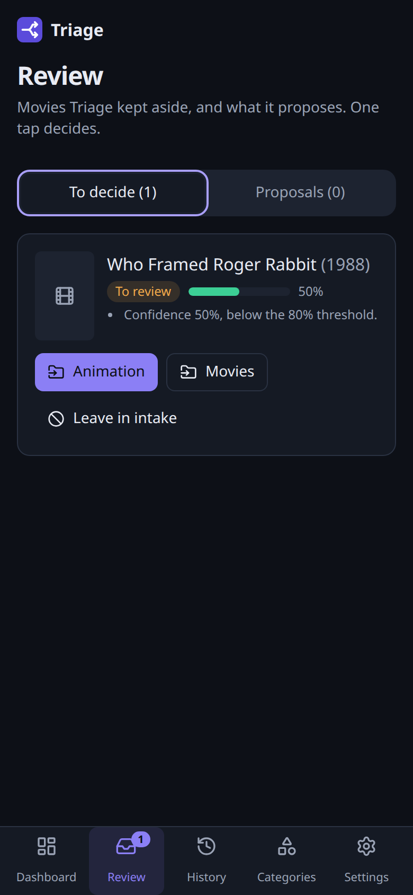
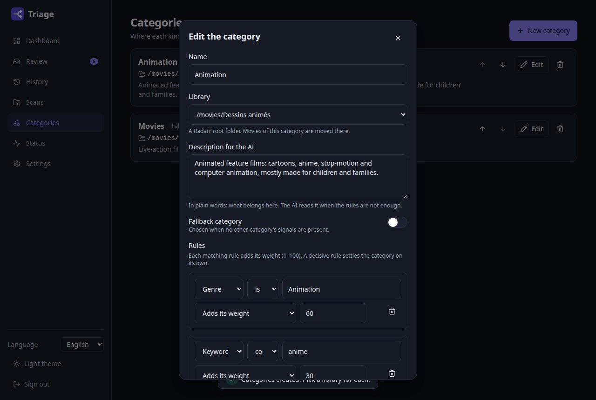
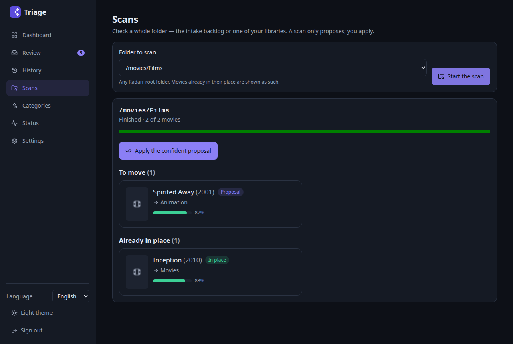
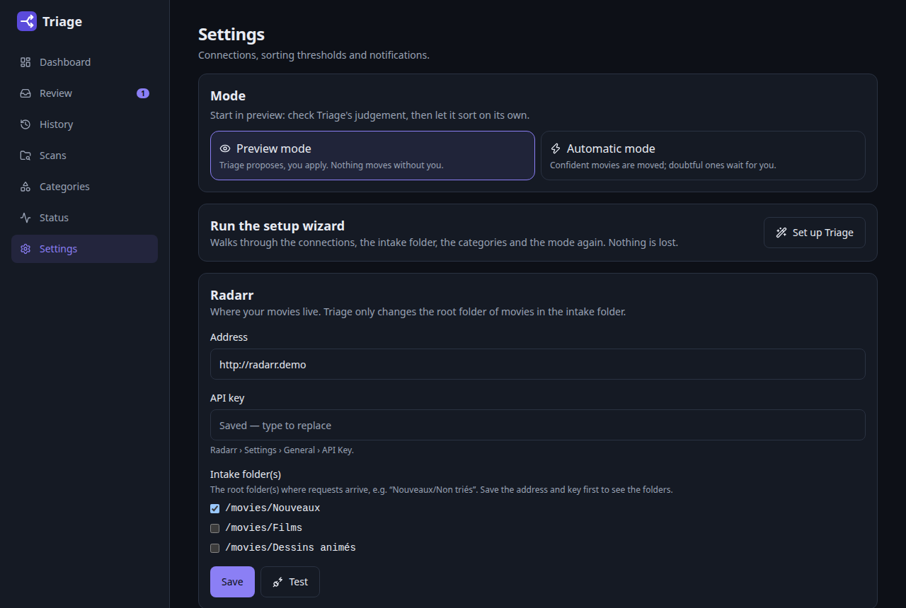
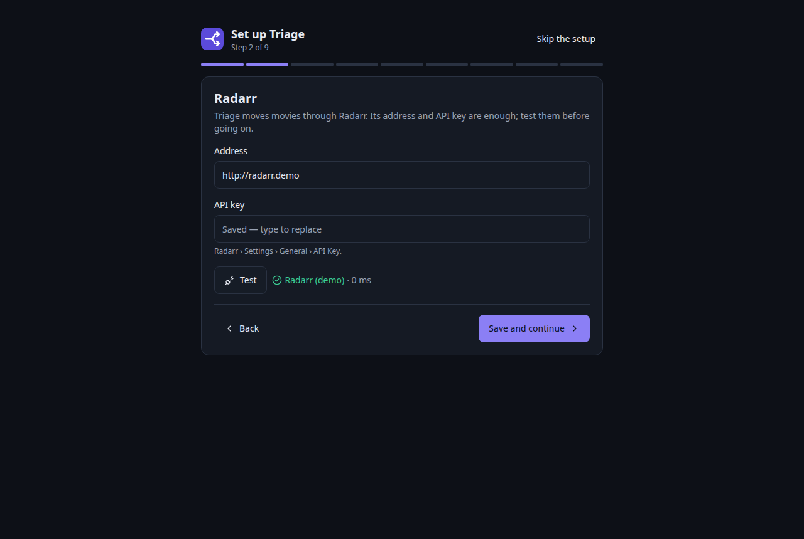

<p align="center">
  
</p>

<h1 align="center">Triage</h1>

<p align="center">
  Sorts newly requested movies into the right Radarr library — with your own rules, a local AI,
  and you in the loop whenever it is not sure.
</p>

---

Household members request movies in **Overseerr** or **Jellyseerr**; the movies land in an *intake*
root folder in **Radarr** (say `Nouveaux/Non triés`). Until now someone had to open Radarr and move
each one to *Movies* or *Animation* by hand.

Triage does it for you:

1. It watches the intake folder (and reacts instantly to the request portal's webhook).
2. It reads each movie's metadata — genres, keywords, production companies, age rating, language —
   and scores it against **your categories**.
3. When the rules are not conclusive, it asks a **local AI** (Ollama), which reads your category
   descriptions and the movie's overview.
4. Confident? The movie is moved to the right library through Radarr. In doubt? It stays where it is,
   and you get an **email with one-click choices** and a review queue on your phone.



## Highlights

- **Your categories, not ours** — *Movies / Animation* is just a preset. Documentaries, kids, concerts,
  languages: any split works, each with its own rules, library, and plain-language description.
- **Safe by default** — starts in **preview mode**: Triage proposes, you apply. It never moves a movie
  it is unsure about, never deletes anything, and never touches movies outside the intake folder.
- **Explainable** — every decision lists the facts it used, the weight of each, the AI's reasoning
  (labelled as interpretation), and the final confidence.
- **Scans** — check a whole folder at once: the intake backlog, or an existing library to find the
  cartoons hiding among your films. Scans only propose.
- **Requests keep working** — a move only changes the movie's root folder through Radarr's editor;
  the movie entry is never recreated, so Overseerr/Jellyseerr requests keep following it.
- **Works without the AI** — rules alone sort most movies; the AI only helps with the ambiguous ones
  (adult animation, live action mixed with animation…).
- **Phone and desktop**, English and French, light and dark.

| Review queue | A decision, explained | On a phone |
|---|---|---|
|  |  |  |

| Categories and rules | Scan a library | Settings |
|---|---|---|
|  |  |  |

## Quick start

```yaml
services:
  triage:
    image: sharkhunterr/triage:latest
    container_name: triage
    ports:
      - "9393:9393"
    volumes:
      - ./config:/config
    environment:
      - TZ=Europe/Paris
      - PUID=1000
      - PGID=1000
    restart: unless-stopped
```

Open `http://<host>:9393` and create your account. A **setup wizard** then walks you through it,
with a *Test* button for every service:



1. **Radarr** — address and API key.
2. **Intake folder** — the root folder where requested movies land.
3. **Categories** — apply the *Movies / Animation* preset and pick a library for each category.
4. Optional: **TMDB**, the local AI (**Ollama**), **email**, **Overseerr / Jellyseerr** — each can be
   skipped and added later.
5. **Mode** — start in **preview** (Triage proposes, you apply), and scan the intake folder right away.

Run it again at any time from *Settings › Run the setup wizard*; everything stays editable in Settings
and Categories.

What the optional services bring:

- **TMDB** API key — adds the full list of production companies and age ratings.
- **Ollama** address and model (e.g. `qwen3:8b`, `mistral:7b`) — the local AI for ambiguous movies.
- **Email** (SMTP) — the one-click review email.
- **Overseerr / Jellyseerr** — shows who requested a movie, and its webhook makes sorting immediate:
  *Settings › Notifications › Webhook*, URL `http://<triage>:9393/api/v1/webhooks/seerr`, the secret
  generated by Triage in *Authorization Header*, events *Request Approved* and
  *Request Automatically Approved*.

Want to look around first? `TRIAGE_DEMO=1` runs Triage on a small built-in library — nothing to
connect.

## How a movie is scored

Each rule that matches adds its weight (1–100) to its category; a *decisive* rule settles the category
on its own. The **fallback** category (e.g. *Movies*) gets a base score when no other category found
anything. Confidence is `top / (top + second + 20)`, so a single weak signal never looks certain.

A movie is moved when the confidence reaches the **threshold** (80 % by default) and the two best
categories are far enough apart (**margin**, 20 by default). Otherwise — and when the AI is consulted
but unsure, unreachable, or slow — it waits for you. The AI's choice counts as one more signal
(`AI weight × its confidence`) and can never override a decisive rule.

## Configuration

| Variable | Default | |
|---|---|---|
| `PUID` / `PGID` | root | user Triage runs as; `/config` is handed over to it |
| `UMASK` | — | e.g. `002` |
| `TZ` | UTC | time zone |
| `TRIAGE_PORT` | `9393` | port |
| `TRIAGE_LOG_LEVEL` | `INFO` | JSON logs on stdout |
| `TRIAGE_DEMO` | — | `1` for the built-in demo library |

Everything else is set in the web interface and stored in `/config/triage.db` (SQLite). Secrets never
leave the server.

## Development

```bash
# backend (Python 3.12, uv)
cd backend && uv sync
uv run triage serve --reload                 # http://localhost:9393
uv run ruff check . && uv run mypy && uv run pytest

# frontend (Node 22)
cd frontend && npm ci
npm run dev                                  # http://localhost:5173, proxies /api to :9393
npm run lint && npm run typecheck && npm test
npm run e2e                                  # Playwright at 360 px and 1280 px, with axe
```

The design lives in `specs/001-movie-triage-mvp/` (specification, plan, data model, API contracts)
and `.specify/memory/constitution.md` (the principles every change follows).

## License

MIT
